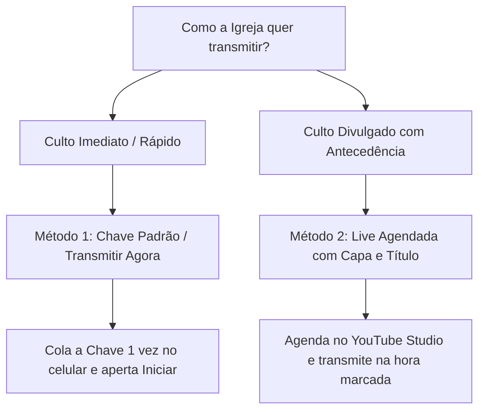
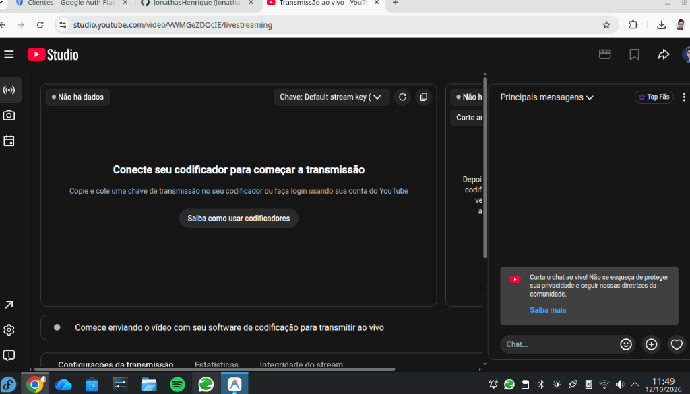
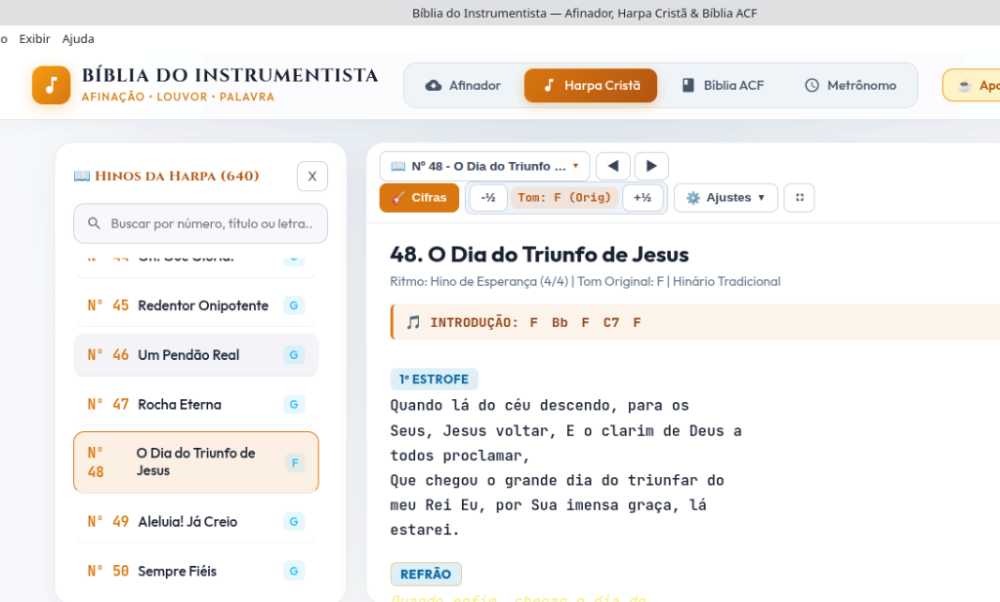
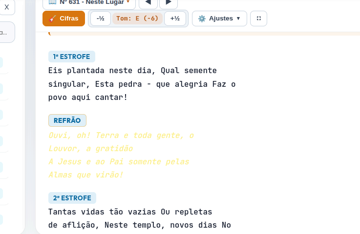
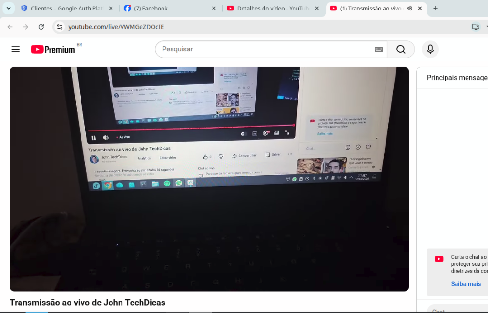
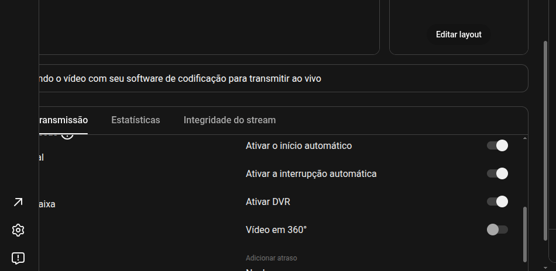

# 🎥 Guia Completo de Transmissão: LiveinFé + YouTube Studio

> **Manual Prático e Visual para Operadores, Voluntários e Equipes de Mídia da Igreja**  
> *Aprenda como transmitir cultos ao vivo pelo celular com qualidade profissional, áudio direto da mesa e proporção 16:9 nativa sem distorções.*

---

## 📌 Sumário
1. [Comparativo: Qual Modo Usar na Sua Igreja?](#1-comparativo-qual-modo-usar)
2. [Método 1: Transmissão Rápida com Chave Padrão (Sem Agendamento)](#2-método-1-transmissão-rápida-com-chave-padrão)
3. [Método 2: Transmissão Profissional Agendada (Com Título, Capa e Horário Marcado)](#3-método-2-transmissão-profissional-agendada)
4. [Passo a Passo no Aplicativo LiveinFé](#4-passo-a-passo-no-aplicativo-liveinfé)
5. [Configurações Importantes no YouTube Studio](#5-configurações-importantes-no-youtube-studio)
6. [Checklist do Operador no Dia do Culto](#6-checklist-do-operador-no-dia-do-culto)
7. [Dúvidas Frequentes e Solução de Problemas](#7-dúvidas-frequentes-e-solução-de-problemas)

---

## 1. Comparativo: Qual Modo Usar?

O YouTube oferece duas formas principais de receber a transmissão do seu aplicativo:

| Recurso | Método 1: Chave Padrão (`((•))`) | Método 2: Transmissão Agendada (`📅`) |
| :--- | :--- | :--- |
| **Ideal para** | Cultos diários, orações, vigílias ou quando não deu tempo de programar. | Cultos principais de domingo, conferências e eventos especiais. |
| **Título e Capa** | Usa o título padrão ou editado previamente no Studio. | Título personalizado para o dia (ex: *"Culto da Família • Pr. João"*). |
| **Link Antecipado** | Usa o link permanente do canal: `youtube.com/@seucanal/live`. | Gera link específico do evento com contagem regressiva para lembrete. |
| **Esforço no Dia** | **Zero esforço**: abre o app e aperta Iniciar. | Abre o app, seleciona a chave e aperta Iniciar. |

---

## 2. Método 1: Transmissão Rápida com Chave Padrão

Neste método, você usa a **Chave de Transmissão Padrão (Default Stream Key)** do canal.

### Passo 1: Localizar a Chave no YouTube Studio
1. Acesse o **[YouTube Studio](https://studio.youtube.com)** no navegador do computador ou celular.
2. No canto superior direito, clique em **Criar** ➔ **Fazer transmissão ao vivo**.
3. No menu lateral esquerdo, clique no primeiro ícone: **`((•))` Transmitir**.

4. No painel central, localize o campo **Chave da transmissão**:
   * Clique no botão **Copiar** (não precisa revelar a chave).

### Passo 2: Colar no Aplicativo LiveinFé
1. Abra o **LiveinFé** no celular.
2. No modo de conexão, selecione **🔑 Chave de Transmissão**.
3. Cole a chave copiada no campo correspondente.
4. O app exibirá: `✅ Chave salva e configurada! Pronto para transmitir.`

> [!TIP]
> **Você só precisa colar essa chave UMA ÚNICA VEZ.**  
> O aplicativo memoriza a chave na memória segura do aparelho. Nos próximos cultos, é só abrir o app e tocar em **Iniciar Transmissão**.

### Passo 3: Iniciar e Encerrar
* **Para Iniciar:** Toque no botão verde **AO VIVO NO YOUTUBE**. Em 3 a 5 segundos, o sinal entra no ar no canal!
* **Controles na Tela:** Você pode travar toques com o cadeado (**Touch Lock**), alternar para lente Ultra-Wide 0.5x e ajustar o zoom com pinça.
* **Para Encerrar:** Toque no botão vermelho **Encerrar Live**. O app corta o sinal e o YouTube encerra e salva o vídeo gravado.

---

## 3. Método 2: Transmissão Profissional Agendada

Se a igreja deseja divulgar a transmissão dias antes no WhatsApp com a arte oficial (capa/miniatura), o tema da mensagem e o nome do pregador:

### Passo 1: Agendar o Culto no YouTube Studio
1. No YouTube Studio, clique no ícone de calendário: **`📅` Gerenciar** (menu esquerdo).
2. Clique no botão azul **Programar transmissão**.
3. Preencha os detalhes do culto:
   * **Título:** Ex: *"Culto de Celebração e Santa Ceia • 18/10/2026"*
   * **Descrição:** Versículos, links para dízimos/ofertas e redes sociais da igreja.
   * **Miniatura:** Envie a imagem da capa do culto (1280x720).
   * **Data e Horário:** Defina o dia e o horário do início do culto.
   * **Visibilidade:** Marque como **Público**.
4. Clique em **Criar transmissão**.

---

## 4. Como Importar a Chave da Live Agendada para o LiveinFé

Existem duas formas fáceis de conectar a live programada ao LiveinFé:

### Opção A: Usando a Chave Padrão na Live Agendada (Recomendado)
Ao criar a transmissão agendada no YouTube Studio:
1. Em **Configurações da transmissão**, no campo **Selecionar chave de transmissão**, escolha:  
   👉 **`Default stream key (RTMP)`**.
2. **Vantagem:** Como o seu LiveinFé já está salvo com essa chave, você **não precisa digitar nada no celular**!
3. Na hora do culto, basta abrir o LiveinFé e iniciar a transmissão. O YouTube direcionará automaticamente o vídeo para a live agendada do dia!

### Opção B: Criando uma Chave Exclusiva para o Evento
1. Se preferir uma chave separada para uma conferência ou congresso, selecione **Criar nova chave de transmissão**.
2. Dê um nome (ex: *"Congresso de Jovens"*).
3. Copie a nova chave gerada e cole no LiveinFé no celular antes de iniciar.

---

## 5. Configurações Importantes no YouTube Studio

Na tela de configurações da transmissão, verifique os seguintes ajustes:

1. **Ativar DVR (Recomendado: LIGADO):**
   * Permite que os espectadores que chegarem atrasados voltem o vídeo para assistir ao louvor ou ao início da pregação.
2. **Latência da transmissão:**
   * **Latência normal:** Melhor estabilidade para conexões de internet móveis.
   * **Baixa latência (Recomendado):** Permite interação rápida no chat (atraso de cerca de 4 a 6 segundos).
3. **Definir transmissão como não listada ao acabar (Opcional):**
   * Mantenha desligado se quiser que o culto continue público no canal após o encerramento.

---

## 6. Checklist do Operador no Dia do Culto

Siga este passo a passo 15 minutos antes do início do culto:

- [ ] **1. Fixação:** Posicione o celular no tripé na altura dos olhos, sem obstruir as lentes.
- [ ] **2. Cabo de Áudio (OTG):** Conecte o adaptador USB OTG no celular com o cabo vindo da saída auxiliar da mesa de som.
- [ ] **3. Bateria:** Conecte o carregador ao celular ou use um hub OTG com alimentação para evitar descarregar durante o culto.
- [ ] **4. Modo Não Perturbe:** Ative o modo "Não Perturbe" no celular para não receber notificações na tela.
- [ ] **5. Fonte de Áudio no App:** No LiveinFé, selecione **Som da Mesa (OTG / Louvor)**.
- [ ] **6. Iniciar Transmissão:** Toque em **AO VIVO NO YOUTUBE** 2 minutos antes do prelúdio para verificar o sinal.
- [ ] **7. Trava de Segurança:** Toque no ícone de cadeado (**Touch Lock**) para evitar toques acidentais durante o culto.

---

## 7. Dúvidas Frequentes e Solução de Problemas

### ❓ Preciso ter um computador ligado durante a live?
> **Não.** O celular envia o sinal diretamente aos servidores do Google via RTMP. O computador só é necessário se alguém quiser moderar comentários no chat.

### ❓ Como compartilho o link da transmissão com os membros?
> No LiveinFé, toque no botão **Compartilhar Link**.  
> Você pode divulgar o link permanente do canal:  
> `https://www.youtube.com/@seucanal/live`  
> Quem abrir esse link enquanto a live estiver rolando já entra direto na transmissão!

### ❓ Se a internet oscilar durante o culto, a transmissão cai?
> **Não.** O LiveinFé possui **Reconexão Automática Contínua** e **Bitrate Adaptativo**. Se o sinal oscilar, ele reduz momentaneamente a taxa de dados sem congelar o áudio e restabelece a qualidade máxima assim que a internet estabilizar.

### ❓ Como destravar a tela se o Touch Lock estiver ativo?
> Pressione e segure o dedo na tela por **2 segundos**. O app vibrará e liberará os controles da câmera e zoom.
